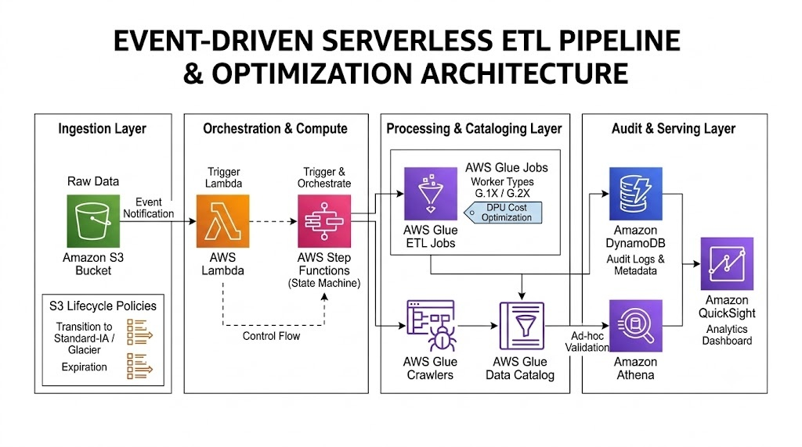

# Serverless Event-Driven NYC TLC Mobility Analytics Platform

[](https://aws.amazon.com/)
[](https://spark.apache.org/)
[](https://www.python.org/)
[](#medallion-data-lake-architecture)
[](LICENSE)

An enterprise-grade, event-driven data engineering platform on AWS processing over 35 million NYC Taxi & Limousine Commission (High Volume For-Hire Vehicle / Lyft) records. Built with AWS Glue, S3 Medallion Architecture, AWS Step Functions, AWS Lambda, Amazon DynamoDB, and Amazon Athena.

---

## Architecture & Workflow

<p align="center">
  
</p>

### Pipeline Execution Flow
```text
       [ NYCTLC CloudFront / External Ingestion ]
                           │
                           ▼
            [ Ingestion Job (Glue Python Shell) ]
     - Probes rolling 6-month historical windows
     - Streaming HTTP multipart upload directly into S3
                           │
                           ▼
                [ S3: raw/nyctlc/ ]
      ├── fhvhv_tripdata/*.parquet (90M-120M records)
      ├── taxi_zone_lookup/*.csv
      └── ingestion.done (Marker File)
                           │
                           ▼ (s3:ObjectCreated:* on ingestion.done)
          [ AWS Lambda: s3-pipeline-trigger ]
                           │
                           ▼ (Starts State Machine Execution)
      [ AWS Step Functions: nyctlc-transform-pipeline ]
                           │
        ┌──────────────────┴──────────────────┐
        ▼ (Distributed PySpark Job)           ▼ (Catch on Failure)
[ Glue: raw-to-curated-etl ]            [ SNS: Topic Alerts ]
 - 10 Data Quality validations                 │
 - Quarantine rejected rows to S3              ▼
 - Join Taxi Zone Lookup tables         [ Email Alert Notification ]
 - Snappy Parquet partitioned by pickup_date
        │
        ▼ (Downstream PySpark Job)
[ Glue: curated-to-aggregated-etl ]
 - Daily Borough Summary (pickup_date, borough)
 - Hourly Pattern Summary (pickup_hour, is_weekend)
 - Route Matrix Summary (pickup/dropoff zone pairs)
        │
        ▼
[ Glue Crawlers (Raw, Curated, Aggregated) ]
        │
        ▼
[ Glue Data Catalog & Amazon Athena (SQL Analytics) ]
        │
        ▼
[ Amazon DynamoDB Audit Log: pipeline-job-audit ]
```

### Core Architecture & Engineering Decisions
- **Marker File Event Trigger Pattern**: The ingestion job writes 6 individual month parquet files. Rather than triggering Lambda on every single file, the ingestion job writes `raw/nyctlc/ingestion.done`. The S3 event notification exclusively listens to this marker file, triggering Lambda and Step Functions once per complete batch.
- **Data Quality & Quarantine Split**: Evaluates 10 deterministic business rules in a single Spark DAG pass. Invalid rows are tagged with explicit reasons (e.g., `trip_miles <= 0`, `dropoff <= pickup`) and written to `s3://.../rejected/nyctlc/` for inspection, preventing bad data from entering downstream layers.
- **Glue DPU Rightsizing**: Benchmarked `G.1X` vs `G.2X` workers. Because operations are not constrained by memory pressure or disk spill, 2x `G.1X` workers ($0.44/DPU-hr) execute the job within SLA while consuming half the billable DPUs compared to `G.2X`.
- **Automated S3 Lifecycle Management**: Configured automated transitions to Standard-IA at 30 days and Glacier Flexible Retrieval at 90 days, while quarantined rejected files auto-delete after 15 days to control storage growth.

---

## Medallion Data Lake Architecture

| Layer | S3 Prefix | Storage Format | Description |
| :--- | :--- | :--- | :--- |
| **Raw** | `s3://.../raw/nyctlc/` | Parquet / CSV | Ingested trip datasets (~90M-120M rows) and taxi zone lookup CSV. |
| **Curated** | `s3://.../curated/nyctlc/` | Parquet (Snappy) | Cleaned, enriched records (~35M Lyft trips) partitioned by `pickup_date`. |
| **Rejected** | `s3://.../rejected/nyctlc/` | Parquet | Quarantined records failing validation checks, with audit reasons logged. |
| **Aggregated** | `s3://.../aggregated/nyctlc/` | Parquet | Three dimensional marts: `daily_borough_summary`, `hourly_pattern_summary`, and `route_summary`. |

---

## Repository Structure

```text
├── athena/
│   └── validation_queries.sql       # SQL verification scripts for Athena
├── configs/
│   └── s3_lifecycle_policy.json     # Storage tiering and auto-cleanup policies
├── glue/
│   ├── nyctlc_ingestion.py          # Python Shell streaming ingestion
│   ├── raw_to_curated.py            # PySpark transformation, DQ checks, zone joins
│   └── curated_to_aggregated.py     # PySpark dimensional aggregations
├── lambda/
│   └── lambda_trigger.py            # Event listener triggering Step Functions
├── step_functions/
│   └── state_machine.json           # Step Functions state machine (ASL)
├── architecture_diagram.png         # Cloud architecture diagram
├── LICENSE                          # Proprietary License
└── README.md
```

---

## Deployment & Setup Guide

### 1. Provision S3 Storage & Apply Lifecycle Policies
```bash
ACCOUNT_ID=$(aws sts get-caller-identity --query Account --output text)
BUCKET_NAME="nyc-mobility-lakehouse-${ACCOUNT_ID}"

aws s3 mb s3://$BUCKET_NAME --region us-east-1

aws s3api put-bucket-lifecycle-configuration \
  --bucket $BUCKET_NAME \
  --lifecycle-configuration file://configs/s3_lifecycle_policy.json
```

### 2. Create DynamoDB Audit Tables
```bash
aws dynamodb create-table \
  --table-name pipeline-job-audit \
  --attribute-definitions AttributeName=job_name,AttributeType=S AttributeName=run_timestamp,AttributeType=S \
  --key-schema AttributeName=job_name,KeyType=HASH AttributeName=run_timestamp,KeyType=RANGE \
  --billing-mode PAY_PER_REQUEST

aws dynamodb create-table \
  --table-name pipeline-datalake-metadata \
  --attribute-definitions AttributeName=pipeline_name,AttributeType=S AttributeName=job_name,AttributeType=S \
  --key-schema AttributeName=pipeline_name,KeyType=HASH AttributeName=job_name,KeyType=RANGE \
  --billing-mode PAY_PER_REQUEST
```

### 3. Deploy Step Functions & Lambda Trigger
Deploy the state machine from `step_functions/state_machine.json`, then deploy the trigger Lambda:

```bash
cd lambda && zip -r function.zip lambda_trigger.py

aws lambda create-function \
  --function-name nyctlc-pipeline-trigger \
  --runtime python3.12 \
  --handler lambda_trigger.lambda_handler \
  --role "arn:aws:iam::${ACCOUNT_ID}:role/nyctlc-lambda-trigger-role" \
  --zip-file fileb://function.zip \
  --environment "Variables={STATE_MACHINE_ARN=arn:aws:states:us-east-1:${ACCOUNT_ID}:stateMachine:nyctlc-transform-pipeline}"
```

Configure the S3 bucket notification to trigger `nyctlc-pipeline-trigger` on `s3:ObjectCreated:*` events filtering for prefix `raw/nyctlc/` and suffix `ingestion.done`.

---

## Data Validation & Analytics in Athena

```sql
-- 1. Validate Curated Trips Count (~35M records)
SELECT COUNT(*) AS total_curated_trips FROM nyctlc_curated.fhvhv_trips_curated;

-- 2. Trips by Borough
SELECT pickup_borough, COUNT(*) AS trips
FROM nyctlc_curated.fhvhv_trips_curated
GROUP BY pickup_borough
ORDER BY trips DESC;

-- 3. Top Routes by Trip Volume & Average Fare
SELECT pickup_zone, dropoff_zone, total_trips, avg_fare
FROM nyctlc_aggregated.route_summary
ORDER BY total_trips DESC
LIMIT 5;

-- 4. Audit Run Log Check
SELECT job_name, layer, status, records_written, duration_seconds, run_timestamp
FROM "pipeline-job-audit"
ORDER BY run_timestamp DESC;
```

---

## 🔒 License

Proprietary and Confidential. All Rights Reserved. See [LICENSE](LICENSE) for details.
